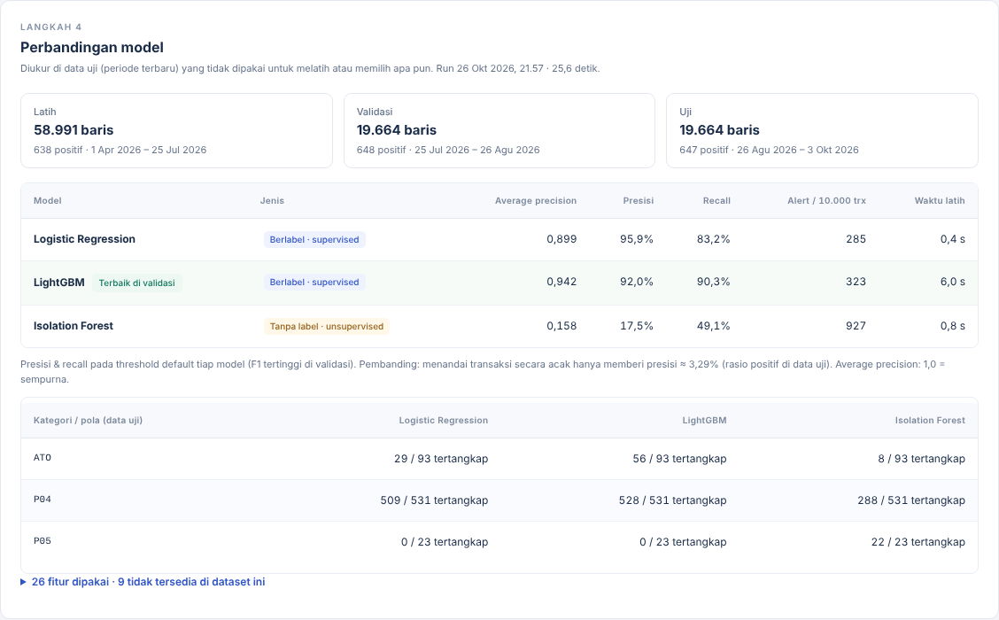

# Model lab — thin slice of the "framework" direction

Branch `lab-thin-slice` (fork `Tohrubo/fcip-financial-crime-mc-fork`), 26 October 2026.
A **possibility to discuss**, not a change to `main`: it shows what FCIP would look
like if the ML work became a framework where a user uploads a labelled dataset,
tunes the setup, compares models and keeps the best one, as the V-TEKI mentors
described. Nothing here activates scoring.



## What it does

A new **Lab model** page (sidebar, Indonesian UI) walks through five steps:

1. **Dataset berlabel** — upload a CSV that has a label column. It is stored
   byte-for-byte with its SHA-256 in `lab_dataset`, *separate from the live
   `transaction` table*: training data carries answers and is never monitored.
2. **Pemetaan kolom** — FCIP suggests which column is the transaction ID,
   account, date, amount, direction, channel, device and so on, and which is
   the label and its positive value; the user can change every choice. Rows
   are validated by the **same normalizer the upload and the offline pipeline
   use** (`app/ml/behavioral/standardize.py`), so bad rows are quarantined with
   the same reasons. Missing optional fields get a recorded neutral value
   (e.g. channel `UNKNOWN`), never a guessed fact. The label column can never
   be mapped as a feature.
3. **Fitur & model** — switch eight feature groups on or off (amount, 7/30-day
   history, deviation from the account's own baseline, 1h/24h velocity, hour of
   day, channel, new device/IP/merchant, source session data) and pick the
   models: **Logistic Regression**, **LightGBM** (supervised) and **Isolation
   Forest** (unsupervised, the current FCIP approach). Choose the training share
   (50–80%).
4. **Hasil & threshold** — a comparison table on the held-out test period
   (average precision, precision, recall, alerts per 10,000 transactions),
   recall per pattern when a category column is mapped, a precision/recall
   curve and a **threshold slider** that shows, in plain words, how many alerts
   a setting creates, how many are right and how many cases are missed.
5. **Simpan draft** — the chosen model + threshold goes into the existing
   `model_version` registry as **DRAFT** (immutable, hashed, with a model
   card). It appears on the Model flags page. A DRAFT never scores anything.

### Protocol (fixed, recorded in every run and model card)

- Chronological split: oldest rows train, the next block validates, the newest
  block tests. Default 60/20/20.
- Features are the existing point-in-time FRAUD set (`behavioral_v1`): history
  comes only from rows before each transaction; medians and vocabularies are
  fitted on the training period only.
- LightGBM early stopping and every model's default threshold (max F1) use the
  validation block. Isolation Forest is fitted without labels.
- The slider shows **validation** figures. **Test** figures for a chosen
  threshold are only revealed when the model is saved, so the threshold is not
  tuned to the test data.
- Artefacts are JSON / LightGBM text, never pickle, like the rest of FCIP.

## Result on the sample dataset (synthetic)

`fcip_lab_sample_s20261026.csv`: 100,000 rows from generator 1.4.0
(`--target-transactions 100000 --min-per-pattern 25 --seed 20261026`), label =
the Fraud model's patterns (ATO, P04, P05), 1,933 positive rows, 1,681 rows
quarantined by validation (duplicate IDs, bad dates, bad currency/amount defects
the generator injects on purpose).

| Model (test period) | Average precision | Precision | Recall | Alerts / 10k |
|---|---:|---:|---:|---:|
| Logistic Regression | 0.899 | 95.9% | 83.2% | 285 |
| **LightGBM** | **0.942** | 92.0% | 90.3% | 323 |
| Isolation Forest | 0.158 | 17.5% | 49.1% | 927 |

Per pattern (test): LightGBM catches P04 528/531 and ATO 56/93 but **P05 0/23**;
Isolation Forest catches **P05 22/23** (dormant accounts waking up look
unusual) but little else. Supervised models win overall; the unsupervised one
covers the pattern that had too few labels to learn. That is an argument for
using both, not one.

**Caveat, as in every FCIP report:** these numbers are high because the data is
synthetic and the scenarios follow the same definitions the labels come from.
They demonstrate the workflow, not real-world detection quality.

Training the three models on 100k rows takes about 25 seconds end to end
(feature building ~12 s).

## How to run it (Docker)

```bash
git fetch origin && git checkout lab-thin-slice
cp .env.example .env            # if you don't have one yet
docker compose up --build       # migration 0010 runs on start
docker compose exec backend python -m app.scripts.seed --users-only
```

Get the sample file: either use the CSV shared with this branch, or generate it
(about 10 s):

```bash
docker compose exec backend python -m app.scripts.generate_raw_dataset \
  --target-transactions 100000 --min-per-pattern 25 --seed 20261026 --out ml_data/lab/raw_s20261026
docker compose exec backend python -m app.scripts.make_lab_sample \
  --raw-dir ml_data/lab/raw_s20261026 --out ml_data/lab/fcip_lab_sample_s20261026.csv
```

The file then sits in `backend/ml_data/lab/` on your machine (git-ignored).
Open http://localhost:5173, log in as `analyst@fcip.internal` /
`DevPassword123!` (or `dataops@`), choose **Lab model**.

## Five-minute demo script

1. Lab model → drag the CSV in, name it, **Unggah dataset**.
2. Point out the suggested mapping (generator column names differ from FCIP's),
   the label `is_fraud` with positive value `1`, category `pattern_code`.
   **Validasi pemetaan** → 98,319 usable rows, 1,681 quarantined with reasons.
3. Leave all feature groups and all three models on → **Latih & bandingkan**
   (~25 s).
4. Comparison table: supervised vs unsupervised on the same data; then the
   per-pattern table (the P05 story above).
5. Threshold: move the slider right — fewer alerts, higher precision, more
   missed cases; switch to Isolation Forest to show the difference.
6. **Simpan sebagai draft** → test figures appear → **Lihat di registry model**.

## Questions this is meant to settle with the mentors

1. Is this the "framework" you meant: upload labelled data, tune, compare,
   save — with the model then used for detection?
2. What should users be able to tune beyond this (feature groups, models,
   split, threshold)? Do you expect custom features or only switches?
3. Which datasets will you upload (format, size, labelled at transaction or
   account level)? Is AML needed at account-week level as in the TRD?
4. **CF-05:** may a saved model, once approved, raise alerts on its own, or
   only add a signal to rule alerts? (The `ML_SCORE` rule is ready but DRAFT.)
5. Who approves a model before it scores live data (FR-405 / MLRO)?

## Not in this slice (next steps if the direction is confirmed)

- Training runs inside the request; larger files need a background job runner.
- Transaction-level (Fraud) unit only; the AML account-week unit is the next
  track (the feature code exists in `behavioral/features.py`).
- No approval flow (FR-405) and no scoring with lab models: the detection run
  only knows the existing model types. Generalising `ml_scoring.py` is the
  riskiest remaining piece.
- No per-transaction explanations for lab models yet (the registry card says
  `explanation_method: none`).
- 50 MB upload limit, same as transaction upload.

## Decisions I took myself (for Jevon to check)

- **Lab data is separate from live data** (new `lab_dataset`, `lab_run`,
  `lab_model` tables, migration 0010); saved models reuse `model_version` as DRAFT
  with `LAB_*` artefact types and feature set `lab:behavioral_v1`.
- **Roles:** Data Ops and Analyst can upload/map/train/save; every role can view.
  No new role was added.
- **Fallbacks for missing fields:** no transaction ID → row number; no direction →
  all `DEBIT`; no channel → `UNKNOWN`; no currency → a stated default (else `XXX`).
  Each is recorded as a note on the dataset. A dataset with several currencies
  trains on the most frequent one only (no FX).
- **Minimum 30 positive and 30 negative rows** to train; every split must contain
  both classes.
- **Default threshold = max F1 on validation; best model = highest validation
  average precision.** Test figures for other thresholds are only shown on save.
- **Sample label rule:** the Fraud model's patterns (ATO, P04, P05), own in-window
  rows of injected positives (as `app/ml/labels.py`); look-alikes and other
  patterns' rows are 0 in this single-label file.
- LightGBM uses `scale_pos_weight = negatives/positives`, so its scores are not
  calibrated probabilities (the default threshold on the sample is ~0.004).

## Ringkasan capstone (Bahasa Indonesia)

Prototipe "Lab model" menunjukkan arah framework yang diminta mentor: pengguna
mengunggah dataset berlabel, memetakan kolom (dengan saran otomatis dan validasi
yang sama dengan upload FCIP), memilih kelompok fitur dan model, lalu
membandingkan Logistic Regression, LightGBM dan Isolation Forest pada periode uji
yang tidak dipakai untuk pelatihan. Threshold dipilih dengan slider pada data
validasi, dan model terpilih disimpan ke registry model FCIP sebagai DRAFT tanpa
mengaktifkan penilaian. Pada data sintetis 100 ribu transaksi, model berlabel
(LightGBM, average precision 0,94) jauh lebih presisi daripada Isolation Forest
(0,16), tetapi Isolation Forest menangkap pola P05 yang terlewat oleh model
berlabel. Angka ini berasal dari data sintetis dan bukan ukuran kinerja produksi.
Alur persetujuan model (FR-405), penilaian data live dengan model lab, unit AML
mingguan, dan keputusan CF-05 belum termasuk.

## Files

Backend: `app/ml/lab/` (mapping, features, trainer), `app/services/lab.py`,
`app/routers/lab.py`, `app/schemas/lab.py`, `app/models/lab.py`,
`alembic/versions/0010_model_lab.py`, `app/scripts/make_lab_sample.py`,
`tests/test_lab.py` (14 tests), small changes to `app/routers/ml.py` (lists lab
drafts), `app/services/audit.py`, `app/main.py`.
Frontend: `pages/LabPage.tsx`, `lab.css`, `api/lab.ts`, `types/lab.ts`, route and
sidebar entry, lab-aware model card on Model flags.

Verification: 698 backend tests pass (684 existing + 14 new); frontend
typecheck and build pass; the full flow was clicked through in headless Chromium
against a live API (upload → map → train → threshold → save → registry), including
the read-only Triage view and a 390 px phone width without horizontal scrolling.
