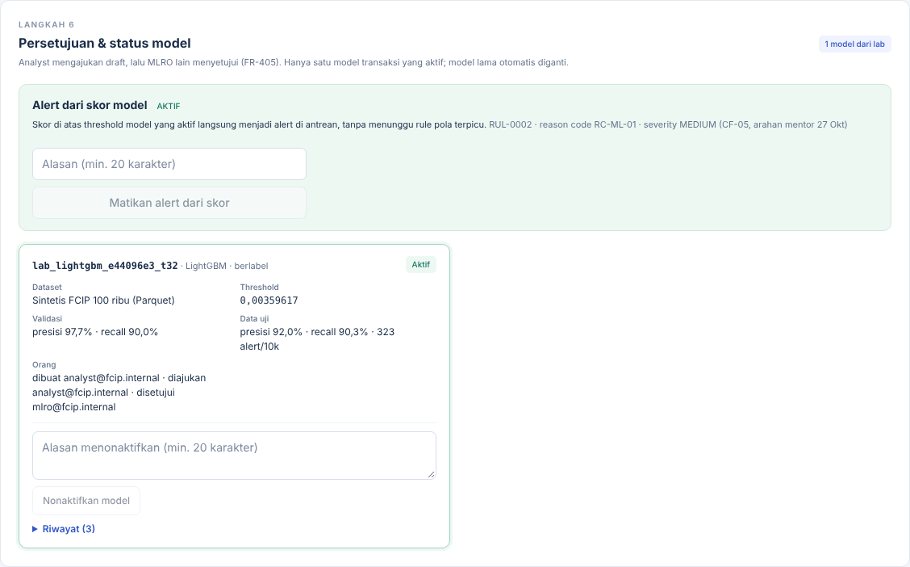

# Model lab — train, approve, monitor

The **Lab model** page is FCIP's detection framework, the direction the V-TEKI
mentors confirmed on 27 October 2026: a user uploads a labelled dataset, tunes
the setup, compares models and keeps the best one; after approval, that model
scores new data and raises alerts on its own, without a pattern rule having to
fire. Started as the 26 Oct thin slice (merged as PR #2); extended on 27 Oct.



## The seven steps (Indonesian UI)

| Step | Who | What happens |
|---|---|---|
| 1. Dataset berlabel | Data Ops, Analyst | Upload a **CSV or Parquet** file with a label column. Stored byte-for-byte with its SHA-256, separate from the monitored `transaction` table. |
| 2. Pemetaan kolom | Data Ops, Analyst | FCIP suggests which column is the ID, account, date, amount, direction… and which is the label; every choice can be changed. Validation and quarantine are the same code the regular upload uses. |
| 3. Fitur & model | Data Ops, Analyst | Switch eight feature groups on or off; compare **Logistic Regression**, **LightGBM** (supervised) and **Isolation Forest** (unsupervised). Chronological split, 50–80% for training. |
| 4. Hasil & threshold | everyone | Comparison on the held-out test period, recall per pattern, precision/recall curve, threshold slider showing alerts per 10,000 transactions. |
| 5. Simpan & ajukan | Data Ops, Analyst | The chosen model and threshold are saved as a DRAFT model version; an **Analyst submits** it with a justification. |
| 6. Persetujuan MLRO | MLRO | An **MLRO other than the submitter** approves (or returns, or later suspends). Approval makes it ACTIVE and retires the previous active model. The MLRO also switches **model alerts** on or off. |
| 7. Pantau data baru | Data Ops | Upload new transactions (CSV or Parquet) **in the same layout as the dataset**. They are ingested as a normal batch, unseen accounts get anonymous records, then detection runs: rules and the active model. |

Alerts raised by the model appear in the normal alert queue as pattern
`ML_SCORE`, labelled "Skor model (tanpa rule pola)", with the model version,
threshold and the features that pushed the score up. Triage, cases and audit
work as for any alert.

## Mentor decisions this implements (27 Oct, relayed by Michael)

- **Framework:** the lab as built is the intended direction.
- **Parquet:** uploads accept Parquet as well as CSV (lab datasets, monitoring
  uploads and the regular transaction upload).
- **CF-05 → (b):** a model score at or above an approved threshold raises an
  alert even when no rule fires. Reason: rules can be learned, and once known,
  activity can be kept just under their thresholds. Built as an MLRO switch of
  the seeded `ML_SCORE` rule (RUL-0002); reason code RC-ML-01 and severity
  MEDIUM remain the team's proposal.
- **Evaluation:** reported the way Jevon's model is evaluated (chronological
  train/validation/test, threshold on validation only, test revealed once).
- **Open, later:** licences of external datasets (FRD CN-02, brief slide 15).

## Rules that keep it honest

- **Every score explains itself** (FRD NG-07, BR-401.3; TRD ADR-007):
  Logistic Regression by weight × standardised value (`linear_log_odds`,
  additive), LightGBM by TreeSHAP (`tree_shap_log_odds`), Isolation Forest by
  median replacement (as Jevon's models).
- **Labels never reach monitoring:** a label column in a monitoring file is
  ignored, with a note.
- **Nobody approves their own model** (FR-405 E1); refusals are recorded.
- **Nothing switches on by default:** `ML_SCORE` stays DRAFT until an MLRO acts.
- **Every step is audited** under the dataset's correlation ID.
- **The platform never tunes itself** (US-1004): a person picks the threshold.

## Result on the sample data (synthetic)

Training file: 100,000 transactions, generator 1.4.0 seed 20261026, label =
the Fraud model's patterns (ATO, P04, P05).

| Model (test period) | Average precision | Precision | Recall | Alerts / 10k |
|---|---:|---:|---:|---:|
| Logistic Regression | 0.899 | 95.9% | 83.2% | 285 |
| **LightGBM** | **0.942** | 92.0% | 90.3% | 323 |
| Isolation Forest | 0.158 | 17.5% | 49.1% | 927 |

Monitoring file: 30,000 new transactions for the six months after training
(seed 20261027, reference date 2027-03-31), as Parquet, with the approved
LightGBM: 29,512 accepted, 488 quarantined with reasons, 994 anonymous account
records, 785 transactions at or above the threshold → **96 model alerts**
(one per account per day), plus 12 P02 rule alerts, in about 16 seconds.

These figures come from synthetic data whose scenarios follow the same
definitions as its labels; they show the workflow, not real-world detection
quality (TRD §10.6, FRD L-01). LightGBM's scores are not calibrated
probabilities (the class weighting shifts them; its threshold is about 0.0036).

## How to run it

```bash
docker compose up --build          # migrations up to 0012 run on start
docker compose exec backend python -m app.scripts.seed --users-only
```

Sample files (git-ignored, regenerated in seconds):

```bash
docker compose exec backend python -m app.scripts.generate_raw_dataset \
  --target-transactions 100000 --min-per-pattern 25 --seed 20261026 --out ml_data/lab/raw_s20261026
docker compose exec backend python -m app.scripts.make_lab_sample \
  --raw-dir ml_data/lab/raw_s20261026 --out ml_data/lab/fcip_lab_sample_s20261026.csv
docker compose exec backend python -m app.scripts.generate_raw_dataset --target-transactions 30000 \
  --min-per-pattern 10 --seed 20261027 --reference-date 2027-03-31 --out ml_data/lab/raw_monitor_s20261027
docker compose exec backend python -m app.scripts.make_lab_sample \
  --raw-dir ml_data/lab/raw_monitor_s20261027 --out ml_data/lab/fcip_monitor_s20261027.csv
```

For Parquet versions, convert either CSV with pandas (`to_parquet`). Logins:
`analyst@`, `mlro@`, `dataops@`, `triage@fcip.internal`, password `DevPassword123!`.

## Demo script (about 8 minutes, four logins)

1. **Analyst** → Lab model → upload the training file → *Validasi pemetaan* →
   *Latih & bandingkan* → show the comparison and the per-pattern table →
   threshold slider → *Simpan sebagai draft* → in step 6, write a
   justification → *Ajukan ke MLRO*.
2. **MLRO** → Lab model → step 6 → note → keep "Skor di atas threshold
   langsung menjadi alert" ticked → *Setujui & aktifkan*. The banner turns
   green: model alerts are on.
3. **Data Ops** → Lab model → step 7 → choose the monitoring file → *Unggah &
   jalankan deteksi* → results → *Buka antrean alert*.
4. **Triage** → open an `ML_SCORE` alert → Model signals → *Lihat detail* shows
   which features drove the score → disposition as usual.

## Not built yet

- Training and monitoring run inside the request (about 25 s for 100k rows);
  bigger files need a background job runner. Lab files are capped at 500,000 rows.
- Transaction-level (Fraud) models only; the AML account-week track is next.
- Live monitoring means "upload, then detect"; there is no streaming feed.
- The approval flow covers lab models; rule approval (FR-304) is still separate.

## Decisions I took myself (for Jevon to check)

Recorded as AS-12 to AS-15 in `PROJECT_CONTEXT.md` §8:
- 500,000-row cap per lab file; Parquet read into the same text cells as CSV (AS-12).
- Monitoring uploads: saved mapping reused, label ignored, batch source
  `MODEL_LAB`, anonymous `OBS-` account proxies for unseen accounts, detection
  right after (AS-13).
- Approval: Analyst submits, MLRO approves/returns/suspends, no self-approval,
  20-character minimum for notes, previous active model retired (AS-14).
- `ML_SCORE` is switched by an MLRO only, never by default; small thresholds are
  printed with two significant digits in alert text (AS-15).
- Also fixed: the two `0010` migrations (lab and Gabriel's roles/cases) left two
  heads, so `alembic upgrade head` failed; `0011_merge_lab_and_roles` joins them.

## Ringkasan capstone (Bahasa Indonesia)

Lab model kini menjadi framework deteksi dari ujung ke ujung, sesuai arahan
mentor V-TEKI tanggal 27 Oktober: pengguna mengunggah dataset berlabel (CSV atau
Parquet), memetakan kolom, membandingkan Logistic Regression, LightGBM dan
Isolation Forest pada periode uji, lalu memilih threshold. Analyst mengajukan
model terpilih, MLRO lain menyetujuinya (FR-405), dan sejak itu model menilai
data transaksi baru yang diunggah Data Ops dengan susunan kolom yang sama. Skor
di atas threshold langsung menjadi alert tanpa harus menunggu rule pola terpicu
(CF-05 opsi b), sehingga deteksi tidak bergantung pada rule yang bisa dipelajari
dan dihindari. Setiap skor menyertakan fitur penyumbangnya, dan setiap langkah
tercatat di audit trail. Pada data sintetis, LightGBM yang disetujui menandai
785 dari 29.512 transaksi baru dan membuat 96 alert. Angka ini berasal dari data
sintetis dan bukan ukuran kinerja produksi; job di latar belakang, jalur AML
mingguan dan lisensi dataset eksternal belum diselesaikan.

## Files

Backend: `app/ml/lab/` (mapping, features, trainer, **scoring**),
`app/services/tabular.py`, `app/services/lab.py`, `app/routers/lab.py`,
`app/schemas/lab.py`, `app/models/lab.py`, migrations `0010_model_lab`,
`0011_merge_lab_and_roles`, `0012_lab_file_format`, `app/scripts/make_lab_sample.py`;
lab support in `app/services/ml_scoring.py`, `app/services/ml_queries.py`,
`app/routers/ml.py`; Parquet in `app/routers/ingestion.py`.
Tests: `tests/test_lab.py`, `tests/test_lab_deploy.py`, `tests/test_tabular.py`.
Frontend: `pages/LabPage.tsx`, `components/LabDeploy.tsx`, `lab.css`,
`api/lab.ts`, `types/lab.ts`; Parquet on the Overview upload; model-alert labels
in the alert queue; linear explanations in `components/ModelSignals.tsx`.
